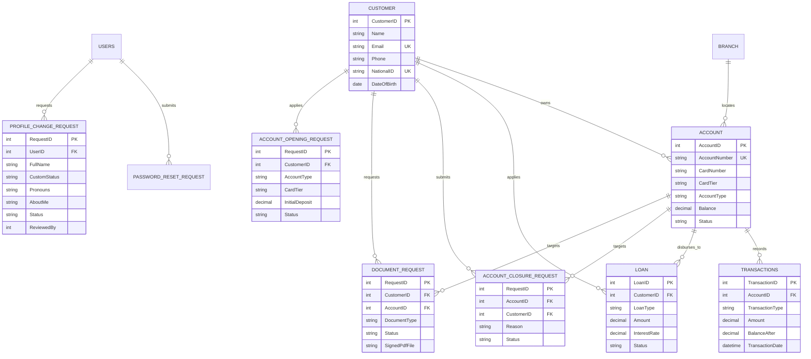

<div align="center">

# ⚡ AkumaBank — Moroccan Cyber Banking Suite 🇲🇦

<p align="center">
  <strong>An enterprise-grade, high-security Moroccan digital banking platform engineered with Python Flask, atomic SQLite ledgers, Bank Al-Maghrib regulatory compliance, vector PDF document generation, and an Operations Requests Hub.</strong>
</p>

[](https://www.python.org/)
[](https://flask.palletsprojects.com/)
[](https://www.sqlite.org/)
[](https://www.reportlab.com/)
[](#-moroccan-banking-standards)
[](#-core-banking-capabilities)
[](#-interface--experience)
[](#-proprietary-license--intellectual-property)

<br/>

<a href="#-whats-new-in-v40">🚀 What's New</a> •
<a href="#-core-banking-capabilities">🏛️ Core Banking</a> •
<a href="#-unified-operations-requests-center">📥 Requests Center</a> •
<a href="#-official-bank-al-maghrib-pdf-suite">📄 PDF Suite</a> •
<a href="#-card-subscription-tiers">💳 Card Tiers</a> •
<a href="#-time-management--subscription-revenue">💸 Time Management</a> •
<a href="#-executive-profile--identity-system">🪪 Profiles</a> •
<a href="#-role-based-access-control-rbac">👥 User Roles</a> •
<a href="#-quick-start--installation">⚡ Quick Start</a> •
<a href="#-database--architecture">🗄️ Architecture</a> •
<a href="#-proprietary-license--intellectual-property">⚖️ License</a>

---

</div>

<br/>

## 🚀 What's New in v4.1

* 👥 **Owner &amp; Admin only:** the Employee role has been retired. `USERS.Role` now allows `Owner / Admin / Customer`, existing Employee logins are migrated to Admin automatically, and staff invitations create Admins.
* 💸 **Time Management in the Owner Studio:** nominate a revenue settlement account by RIB, then press **Collect Subscriptions** to charge every active card subscription into it. The MAD 10.00 transfer fee and MAD 1.00 deposit fee settle there as well.
* 📉 **Overdrafts are allowed and enforced:** a subscription the customer cannot cover pushes the account negative, and an overdrawn account cannot be closed or request closure until it is settled. The closure certificate (Quittus) exists only for accounts that are already closed.
* ⚡ **Live data everywhere:** open views refresh themselves whenever the database changes, so approvals, balances and requests appear without a manual reload. While a form is being edited or a modal is open, a chip offers the update instead of interrupting.
* 🧹 **Complete reset utility:** `tools/reset_db.py` also clears badges, custom roles and subscription billing history, and reports exactly what it removed.

---

## 🚀 What's New in v4.0

AkumaBank v4.0 introduces major architectural enhancements tailored to authentic Moroccan and international retail banking standards:

* 📥 **Unified Operations Requests Center (`/requests`):** A centralized command hub managing all 7 request lifecycles (Customer Signups, Account Openings, Account Closures, Document Certifications, Loan Underwriting, Password Resets, and Profile Changes) with real-time pending badges.
* 📄 **Official Bank Al-Maghrib PDF Generation Suite:** 6 regulatory PDF certificates dynamically rendered with ReportLab, featuring clean vector EMV smart cards, Bank Al-Maghrib circular stamps, and electronic signatures.
* 📁 **Customer "My Documents" Portal (`/my-documents`):** Self-service document issuance with a dynamic state lifecycle — customer requests certificate &rarr; staff inspects draft &rarr; uploads physically signed/stamped PDF &rarr; customer's **"Cancel Request"** button transforms into **"Download PDF"**.
* 💳 **Multi-Tier Card Subscription Framework:** 4 distinct Moroccan banking tiers (`Silver Pulse`, `Titanium Elite`, `Gold Sovereign`, and `Obsidian Noir`) with specific spending ceilings, contactless limits, and insurance coverage.
* 🪪 **Discord-Style Executive Profile Cards:** Banners, overlapping avatars, a framed badge tray, PNG role pills and sectioned About / Roles / Accounts blocks, shared by every member and served identically in the global profile popup.
* 🎖️ **Owner Studio (`/owner/studio`):** Owners design custom roles and official badges from uploaded PNGs, then grant roles and badges to any member. Glyph-based badges were retired in favour of image icons.
* 🛡️ **Approval-Gated Customer Profiles:** Customers can no longer rewrite their display name, status, title or bio directly &mdash; those edits become requests that an Owner or Admin reviews in the Requests Center.
* 🖼️ **Served Avatar &amp; Banner Routes:** Uploads are compressed in memory (256&times;256 WebP avatars, 1024&times;400 banners, animated GIFs resized frame-by-frame) and streamed from `/user/<id>/avatar` and `/user/<id>/banner`, so the session cookie stays tiny.
* 🪟 **Official Bank Document Windows:** Clean, responsive modals replace cramped dropdowns, providing in-browser preview (`target="_blank"`) and direct file downloads for all accounts.

---

## 🏛️ Core Banking Capabilities

* 🇲🇦 **Moroccan Banking Standards (BAM):**
  * **24-Digit RIB Generation:** Authentic Bank Al-Maghrib Modulo 97 checksum validation (`generate_moroccan_rib`).
  * **16-Digit Payment Cards:** Deterministic Luhn algorithm (`generate_card_number`) matching ISO/IEC 7812.
  * **Fee Model:** Standard **MAD 1.00** deposit administrative fee and **MAD 10.00** inter-account transfer fee deducted automatically from recipient funds.
* 🔄 **Atomic Transaction Ledgers:** Guaranteed zero concurrency drift via SQLite immediate transactions and SQL trigger `UpdateBalanceAfterTransaction`.
* 🛡️ **Account Liquidation & Closure Protocol:** Liquidates balances to MAD 0.00, permanently deactivates cards, and issues an official Bank Discharge certificate (*Quittus*).
* 🪙 **Credit Facilities & Loan Underwriting:** Full credit application lifecycle (Home, Car, Personal, Academic, Business) with variable interest rates and direct disbursement into active checking accounts.
* 🔐 **Temporary Password & Access Recovery:** Password resets are approved by administration, issuing single-use credentials with forced rotation on subsequent sign-in.

---

## 📥 Unified Operations Requests Center

All bank requests are consolidated into a dedicated, full-page operations workspace accessible from the sidebar at `/requests` or via quick-action modals:

<table>
  <thead>
    <tr>
      <th>Request Category</th>
      <th>Triggered By</th>
      <th>Administrative Action</th>
      <th>Final Artifact / Result</th>
    </tr>
  </thead>
  <tbody>
    <tr>
      <td><strong>👤 Customer Signups</strong></td>
      <td>Prospective customer registration</td>
      <td>Verify National ID (CIN), approve applicant</td>
      <td>Generates customer profile &amp; enables account opening</td>
    </tr>
    <tr>
      <td><strong>💳 Account Openings</strong></td>
      <td>Existing customer portal application</td>
      <td>Approve card tier &amp; initial deposit</td>
      <td>Generates 24-digit Moroccan RIB &amp; 16-digit card</td>
    </tr>
    <tr>
      <td><strong>❌ Account Closures</strong></td>
      <td>Customer closure submission</td>
      <td>Authorize liquidation &amp; discharge</td>
      <td>Zero-balances account &amp; generates Quittus PDF</td>
    </tr>
    <tr>
      <td><strong>📄 Official Documents</strong></td>
      <td>Customer certificate request</td>
      <td>Preview draft &amp; upload signed physical PDF</td>
      <td>Customer "Cancel" button &rarr; "Download PDF"</td>
    </tr>
    <tr>
      <td><strong>🪙 Loan Applications</strong></td>
      <td>Customer credit application</td>
      <td>Underwrite rate &amp; assign disbursement account</td>
      <td>Capital disbursed into active account ledger</td>
    </tr>
    <tr>
      <td><strong>🔑 Password Resets</strong></td>
      <td>Customer forgotten credentials</td>
      <td>Issue temporary password</td>
      <td>Delivered via Temporary Passwords Queue</td>
    </tr>
    <tr>
      <td><strong>🪪 Profile Changes</strong></td>
      <td>Customer edits display name, status, title or bio</td>
      <td>Review the before &rarr; after diff, approve or reject</td>
      <td>Identity fields applied to the customer's card on approval</td>
    </tr>
  </tbody>
</table>

> [!TIP]
> A live notification badge in the sidebar dynamically displays the aggregate number of all pending requests across the entire bank.

---

## 📄 Official Bank Al-Maghrib PDF Suite

AkumaBank integrates a vector PDF compilation engine built on ReportLab. Every document includes Bank Al-Maghrib legal mentions, Modulo 97 verification, branch domiciliation, and digital seal blocks:

| Document Type | Purpose &amp; Regulatory Standard | Visual Elements Included |
| :--- | :--- | :--- |
| **Welcome Pack &amp; Opening Cert** | Official confirmation of bank account creation | Vector credit card matching tier template, BAM license BAM/2026/088 |
| **Official 24-Digit RIB Slip** | Banking identity statement for salary &amp; direct debits | 24-digit split RIB (Bank, Guichet, Account, Key), IBAN, BIC |
| **Card Subscription Agreement** | Contractual card documentation &amp; ceilings | Card visual template, EMV chip parameters, contactless &amp; insurance specs |
| **Account Statement &amp; Logs** | Certified financial history &amp; ledger movements | Chronological transaction table, running balances, credit/debit totals |
| **Attestation de Solvabilité** | Solvency certificate for visa &amp; administrative bodies | Certified liquid balance statement, branch manager signature stamp |
| **Account Closure Quittus** | Official liquidation and debt discharge certificate | Final liquidation settlement confirmation, definitive zero-balance seal |

### Vector Credit Card Rendering
The visual credit card rendered inside Welcome Packs and Card Agreements is drawn with clean vector geometry:
* **EMV Microchip:** Realistic metallic 4-pad contact grid with gold trim.
* **Contactless Indicator:** Crisp typographic wave emitter (`))))`).
* **Card Details:** Masked 16-digit number (`4532 •••• •••• 9012`), expiration date, cardholder legal name, and VISA branding.
* **Zero Circles:** Clean rectangular layout matching physical smart cards.

---

## 💳 Card Subscription Tiers

AkumaBank offers 4 tailored card subscription tiers:

```
[ Silver Pulse ]       [ Titanium Elite ]       [ Gold Sovereign ]       [ Obsidian Noir ]
   Standard                  Premium                   Gold                    Black
 0 MAD / month            49 MAD / month          99 MAD / month          199 MAD / month
```

<table>
  <thead>
    <tr>
      <th>Tier</th>
      <th>Display Name</th>
      <th>Monthly Fee</th>
      <th>Max Balance Ceiling</th>
      <th>Contactless Limit</th>
      <th>Insurance &amp; Privileges</th>
    </tr>
  </thead>
  <tbody>
    <tr>
      <td><code>standard</code></td>
      <td><strong>Silver Pulse</strong></td>
      <td>Free (0 MAD)</td>
      <td>MAD 50,000</td>
      <td>MAD 200 / tap</td>
      <td>National ATM/POS network &bull; 3D Secure e-commerce</td>
    </tr>
    <tr>
      <td><code>premium</code></td>
      <td><strong>Titanium Elite</strong></td>
      <td>MAD 49 / mo</td>
      <td>MAD 200,000</td>
      <td>MAD 400 / tap</td>
      <td>Morocco airport lounge &bull; International payment enablement</td>
    </tr>
    <tr>
      <td><code>gold</code></td>
      <td><strong>Gold Sovereign</strong></td>
      <td>MAD 99 / mo</td>
      <td>MAD 500,000</td>
      <td>MAD 600 / tap</td>
      <td>Global VIP lounges &bull; All-risk medical &amp; travel insurance</td>
    </tr>
    <tr>
      <td><code>black</code></td>
      <td><strong>Obsidian Noir</strong></td>
      <td>MAD 199 / mo</td>
      <td>Unlimited</td>
      <td>MAD 1,000 / tap</td>
      <td>24/7 dedicated concierge &bull; Bespoke financial ceilings</td>
    </tr>
  </tbody>
</table>

---

## 💸 Time Management & Subscription Revenue

The Owner Studio (`/owner/studio`) doubles as the bank's billing control centre, turning card subscriptions and transaction fees into real bank income.

### Revenue Settlement Account

The Owner nominates one existing account by its 24-digit RIB. Every fee the bank retains is credited to that account's ledger in the same atomic transaction as the operation that generated it:

| Revenue Source | Amount |
| :--- | :--- |
| Deposit administrative fee | MAD 1.00 per deposit |
| Inter-account transfer fee | MAD 10.00 per transfer |
| Monthly card subscription | per tier — MAD 0 (free plans) up to MAD 290 |

Saving an empty RIB detaches the settlement account and the bank stops crediting fees to a customer ledger. Only active accounts can hold revenue.

### Collecting Subscriptions

The **Collect Subscriptions** button is a one-click collection: it charges every active account's card subscription fee right now and credits the money to the revenue settlement account.

* Every active account whose card tier carries a monthly fee is debited for that fee.
* The collected amount is credited to the revenue settlement account in the same atomic transaction.
* Each click records a `SUBSCRIPTION_RUN` and one `SUBSCRIPTION_CHARGE` row per account with its tier, amount and resulting balance.
* Accounts that cannot cover the fee are still charged: the balance simply goes negative, becoming an overdraft.
* The studio shows total revenue collected, per-run totals and the most recent individual charges.

### Overdrawn Accounts

A negative balance is a real state, not a rejected charge:

* An overdrawn account (including one whose balance is exactly negative after a subscription run) cannot be closed — neither by a staff officer from the Accounts page nor by approving a closure request.
* Customers cannot submit a closure request for an overdrawn account; the portal labels it **Overdrawn** instead of offering the closure button.
* The closure certificate (Quittus) is generated only for accounts whose status is `Closed`, so it is unavailable before the account is actually closed — for customers, Admins and the Owner alike.

### Live Updates (No Manual Refresh)

Every page polls `/api/live/version`, a cheap fingerprint of the SQLite file. When any signed-in user changes data, the fingerprint changes and every open view reloads itself, keeping its scroll position. If a form is being edited, a file is selected or a modal is open, the reload waits and a **New bank data — click to update** chip appears instead of interrupting the work.

---

## 🪪 Executive Profile & Identity System

Every staff member and customer receives a Discord-style executive profile card: banner, overlapping avatar with a status dot, framed badge tray, PNG role pills, and sectioned About Me / Roles / Accounts blocks. Badges and role icons are uploaded PNGs only &mdash; glyph-based badges were retired.

### Avatars &amp; Banners (Served, Not Embedded)

1. **Upload &amp; Validate:** JPEG, PNG, WebP and animated GIF up to 8&nbsp;MB are decoded in memory with Pillow.
2. **Normalize &amp; Compress:** Avatars become 256&times;256 WebP (animated GIFs are resized frame-by-frame, capped at 150 frames); banners become 1024&times;400 WebP.
3. **Store in SQLite:** The compressed bytes are kept as a data URI on `USERS.ProfilePicture` and `USERS.BannerImage`. **Zero image files are written to disk.**
4. **Serve by Route:** `/user/<id>/avatar` and `/user/<id>/banner` stream the bytes with private caching and a version query string so new uploads replace cached ones instantly.
5. **Small Sessions:** The session cookie stores only a `has_pfp` flag and an avatar version &mdash; never the image itself.
6. **Site-Wide Use:** The same routes feed the sidebar, topbar, profile card, settings preview, global profile popup, staff tables and Owner Studio.

### Owner Studio (`/owner/studio`, Owner only)

* Create custom profile roles with a color and optional PNG icon (rendered as a 16px pill icon, with a colored dot fallback) and delete them with one click.
* Register official bank badges from square PNG icons (64&times;64), each with a description and accent color, or delete them from the registry.
* Nominate the bank's revenue settlement account by RIB and advance subscription billing months from the Time Management panel.
* Assign badges and roles to any member from the studio member table, a profile card, or the global profile popup.
* Role member counts and both registries stay visible while you work, and every studio action returns to the studio.

### Badge Hover Card

Hovering any badge icon &mdash; on the profile card, settings preview, global profile popup or Owner Studio members table &mdash; opens a floating card with the badge icon, name, an "Official Bank Badge" label and its description. It positions above the badge, flips below when space runs out, and clamps to the viewport edges.

### Customer Profile Change Requests

Customers cannot rewrite their own identity fields. Saving **About Me &amp; Status** creates a `PROFILE_CHANGE_REQUEST` holding the proposed display name, custom status, title and bio instead of updating `USERS`. The settings page shows the request state (pending or rejected) and previews the proposed values on the live card. Owners and Admins review requests in **Requests Center &rarr; Profile Changes**, which shows a before &rarr; after diff per field, and approval applies the values while recording the reviewer and timestamp. Avatar and banner uploads remain self-service.

---

## 👥 Role-Based Access Control (RBAC)

AkumaBank enforces strict operational separation across 3 distinct user roles — the Employee role was retired in v4.1, and every staff member is now an Admin:

| Capability | 👑 Owner | 🛡️ Admin | 👤 Customer |
| :--- | :---: | :---: | :---: |
| **System Dashboard &amp; Telemetry** | ✅ | ✅ | ❌ |
| **Review Customer Signups** | ✅ | ✅ | ❌ |
| **Create &amp; Open Accounts** | ✅ | ✅ | ❌ |
| **Close &amp; Liquidate Accounts** | ✅ | ✅ | ❌ |
| **Approve / Sign Official PDFs** | ✅ | ✅ | ❌ |
| **Underwrite &amp; Disburse Loans** | ✅ | ✅ | ❌ |
| **Manage Staff Users** | ✅ | ❌ | ❌ |
| **Owner Studio (Roles, Badges &amp; Billing)** | ✅ | ❌ | ❌ |
| **Approve Profile Change Requests** | ✅ | ✅ | ❌ |
| **Edit Own Profile Identity** | ✅ | ✅ | 📝 Request |
| **Client Portal Self-Service** | ❌ | ❌ | ✅ |
| **Customer Document Requests** | ❌ | ❌ | ✅ |

---

## ⚡ Quick Start & Installation

### Prerequisites
* **Python 3.8** or newer
* **pip** package manager
* **SQLite3** (bundled with Python)

### 1. Clone the Repository
```bash
git clone https://github.com/akuma3232/AkumaBank.git
cd AkumaBank
```

### 2. Set Up Virtual Environment
<details open>
<summary><b>Linux / macOS (Bash / Zsh)</b></summary>

```bash
python3 -m venv .venv
source .venv/bin/activate
```
</details>

<details>
<summary><b>Windows (PowerShell)</b></summary>

```powershell
python -m venv .venv
.\.venv\Scripts\Activate.ps1
```
</details>

### 3. Install Dependencies
```bash
pip install -r requirements.txt
```

### 4. Initialize Database & Provision Master Owner
```bash
# Provision the first master administrative credentials
python tools/create_owner.py
```
> [!IMPORTANT]
> The setup prompt will ask for a staff username, email, and password. Once created, the tool locks down to prevent duplicate owner provisioning.

### 5. Launch Application
```bash
python app.py
```

Open your browser at:
```text
http://127.0.0.1:5000
```
* Sign in as staff via **Staff Login**.
* Register a new account via **Apply for Customer Account**.

---

## 🗂️ Project Directory Structure

```text
AkumaBank/
├── app.py                         # Application factory, blueprints & context processors
├── database.py                    # SQLite engine, triggers, liquidation, billing & revenue settlement
├── card_tiers.py                  # Moroccan card subscription tiers (Silver/Titanium/Gold/Obsidian)
├── morocco_banking.py             # 24-digit BAM Modulo 97 RIB & 16-digit Luhn card generator
├── pdf_generator.py               # ReportLab official PDF compilation & vector card engine
├── requirements.txt               # Dependencies (Flask, ReportLab, Pillow)
├── schema.sql                     # Reference SQL schema definition
├── LICENSE                        # Proprietary software license
├── README.md                      # Comprehensive documentation
├── database/
│   ├── banking_system.db          # SQLite production database
│   └── signed_documents/          # Storage for staff-uploaded physically signed PDFs (.gitignore)
├── routes/
│   ├── accounts.py                # Accounts management, Requests Center & opening approval
│   ├── auth.py                    # Authentication, sessions, signups & recovery
│   ├── branches.py                # Moroccan branch directory (Casablanca, Rabat, etc.)
│   ├── customer_portal.py         # 3D holographic cards, transfers, loan & opening requests
│   ├── customers.py               # Customer directory & signup approval logic
│   ├── dashboard.py               # Executive telemetry & Chart.js inflow/outflow charts
│   ├── database_panel.py          # Interactive SQL query console & table explorer
│   ├── documents.py               # PDF downloads, draft preview, and signature upload
│   ├── live.py                    # Live-update version endpoint for auto-refresh
│   ├── loans.py                   # Credit underwriting & loan disbursement
│   ├── profiles.py                # Profile cards, Owner Studio, roles, badges, avatars & requests
│   ├── reports.py                 # Financial audit statements & balance sheets
│   ├── transactions.py            # Deposit, withdrawal, and transfer ledger
│   └── users.py                   # Staff credentials, password resets & profile change approvals
├── static/
│   ├── css/
│   │   └── style.css              # Design system, glassmorphism, 3D card tilt, dark/light theme
│   └── js/
│       └── main.js                # Command HUD (Ctrl+K), Web Audio oscillators, 3D tilt engine
├── templates/
│   ├── base.html                  # Master layout with Command HUD, theme switcher & sidebar
│   ├── accounts.html              # Bank accounts list with official PDF tools modals
│   ├── requests_center.html       # Full-page unified Operations Requests Center (7 categories)
│   ├── customer_documents.html    # Customer 'My Documents' portal with Cancel/Download actions
│   ├── customer_portal.html       # Customer banking portal with 3D cards & request actions
│   ├── customers.html             # Customer directory with direct account PDF jump links
│   ├── dashboard.html             # Executive telemetry & Chart.js analytics
│   ├── account_settings.html      # Live profile card preview, avatar/banner uploads & bio requests
│   ├── profile_card.html          # Standalone executive profile card with Owner assignment modals
│   ├── owner_studio.html          # Owner Studio: roles, badges, members & subscription billing
│   └── ...                        # Supporting templates (login, register, loans, reports...)
└── tools/
    ├── create_owner.py            # Initial administrator provisioner CLI
    └── reset_db.py                # Full reset: banking data, users, badges, roles & billing
```

---

## 🗄️ Database Architecture & Entity Relationships

AkumaBank enforces strict relational integrity with SQLite `PRAGMA foreign_keys = ON`:



---

## 🛠️ Maintenance & Reset Utilities

To purge all business records and test user accounts without altering the schema:
```bash
python tools/reset_db.py
```
> [!NOTE]
> This safely disables foreign keys, flushes every transaction, account, loan, request, customer, user, badge, custom role and subscription-billing table, resets SQLite sequence counters, clears the revenue settlement setting and re-enables constraints. The command reports what was removed and lists any table that still holds rows. Recreate the master administrator using `python tools/create_owner.py`.

---

## ⚖️ Proprietary License & Intellectual Property

```text
PROPRIETARY SOFTWARE LICENSE — ALL RIGHTS RESERVED
Copyright (c) 2026 AkumaBank. All Rights Reserved.
```

> [!CAUTION]
> **Strict Prohibition on Modification & Redistribution:**  
> This software codebase, its UI styling, 3D card physics, ReportLab PDF generation algorithms, and database structures are the exclusive proprietary property of the Author.  
> 
> **No person or entity is permitted to:**
> - Modify, alter, adapt, or create derivative works of any file in this repository.
> - Fork, copy, clone, distribute, sublicense, sell, or mirror the code publicly or privately.
> - Reverse-engineer, decompile, or extract the proprietary components.
> 
> Refer to the full [LICENSE](LICENSE) file for legal provisions.

---

<div align="center">
  <sub>Engineered with precision for Bank Al-Maghrib compliance &bull; <strong>AkumaBank Core v4.0</strong></sub>
</div>
