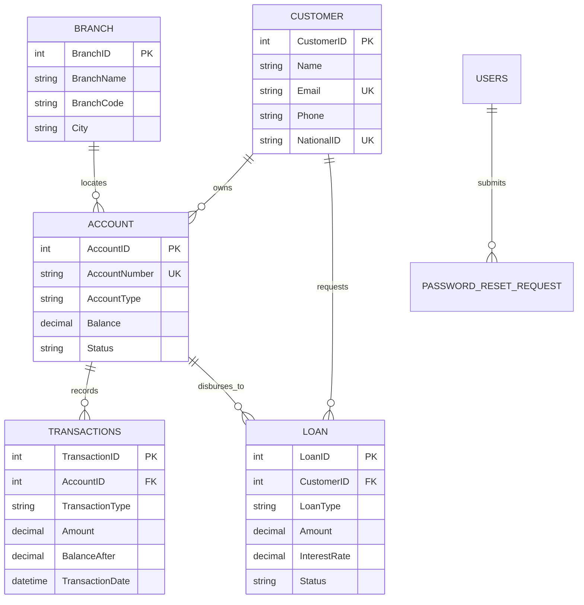

<div align="center">

# ⚡ AkumaBank — Next-Gen Cyber Banking Suite 🇲🇦

<p align="center">
  <strong>An ultra-modern, high-security Moroccan banking management system engineered with Python Flask, SQLite atomic ledgers, 3D holographic virtual banking cards, and cyber-fintech architecture.</strong>
</p>

[](https://www.python.org/)
[](https://flask.palletsprojects.com/)
[](https://www.sqlite.org/)
[](#-moroccan-financial-specifications)
[](#-future-ui--cyber-features)
[](#-proprietary-license--intellectual-property)

<br/>

<a href="#-future-ui--cyber-features">🌟 Future UI Features</a> •
<a href="#-core-banking-capabilities">🏛️ Core Banking</a> •
<a href="#-quick-start--installation">🚀 Quick Start</a> •
<a href="#-role-based-access-control-rbac">👥 User Roles</a> •
<a href="#-database--architecture">🗄️ Architecture</a> •
<a href="#-proprietary-license--intellectual-property">⚖️ License</a>

---

</div>

<br/>

## 🌟 Future UI & Cyber Features

AkumaBank features an industry-grade, cutting-edge **Future UI Design System** blending cyberpunk aesthetics with clean Swiss fintech clarity:

<table>
  <tr>
    <td width="50%" valign="top">
      <h3>🌓 Cyber Dark &amp; Crisp Light Mode</h3>
      <ul>
        <li><strong>Deep Obsidian Canvas:</strong> <code>#070b14</code> background with ambient radial glowing mesh and neon cyan (<code>#00f2fe</code>) / electric indigo accents.</li>
        <li><strong>Frosted Glassmorphism:</strong> Translucent panels styled with <code>backdrop-filter: blur(18px)</code>.</li>
        <li><strong>Zero-Flicker State:</strong> Inline pre-render initialization script remembers theme preference in <code>localStorage</code>.</li>
      </ul>
    </td>
    <td width="50%" valign="top">
      <h3>💳 3D Holographic Virtual Cards</h3>
      <ul>
        <li><strong>Physics-Based Tilt:</strong> Real-time 3D cursor tracking (<code>rotateX</code> / <code>rotateY</code>) with dynamic holographic light sheen.</li>
        <li><strong>Realistic EMV Chip:</strong> Golden micro-circuitry lines, contactless wave icons, and tier badges (<em>Quantum Savings</em>, <em>Platinum Current</em>).</li>
        <li><strong>Mask &amp; One-Click Copy:</strong> Eye icon toggles unmasked numbers; clipboard button triggers audio-visual toast feedback.</li>
      </ul>
    </td>
  </tr>
  <tr>
    <td width="50%" valign="top">
      <h3>⚡ Command HUD Spotlight (<code>Ctrl + K</code>)</h3>
      <ul>
        <li><strong>Instant Action Palette:</strong> Press <code>Ctrl + K</code> (or <code>⌘ + K</code>) anywhere to invoke a glowing HUD spotlight search.</li>
        <li><strong>Fuzzy Navigation:</strong> Quick jump to any page, execute theme toggles, search accounts, or sign out with keyboard arrows and <code>Enter</code>.</li>
      </ul>
    </td>
    <td width="50%" valign="top">
      <h3>🇲🇦 Casablanca Clock &amp; BAM FX Ticker</h3>
      <ul>
        <li><strong>Casablanca Local Time:</strong> Real-time ticking financial clock (<code>GMT+1</code> Casablanca / Africa) with live seconds.</li>
        <li><strong>Interbank FX Ticker:</strong> Indicative Bank Al-Maghrib rates for <strong>EUR/MAD</strong>, <strong>USD/MAD</strong>, <strong>GBP/MAD</strong>, and <strong>AED/MAD</strong>.</li>
        <li><strong>Quantum Sentinel:</strong> Visual 256-bit AES encryption health pulse.</li>
      </ul>
    </td>
  </tr>
  <tr>
    <td width="50%" valign="top">
      <h3>🔊 Web Audio Synthetic Micro-Feedback</h3>
      <ul>
        <li><strong>Zero-Asset Audio:</strong> Built-in acoustic micro-feedback generated dynamically via native HTML5 Web Audio API oscillators.</li>
        <li><strong>Micro-Interactions:</strong> Subtle high-tech audio blips on clicks, modal reveals, and clipboard copies (can be muted anytime).</li>
      </ul>
    </td>
    <td width="50%" valign="top">
      <h3>📊 Dynamic Executive Telemetry</h3>
      <ul>
        <li><strong>Chart.js Theme Sync:</strong> Inflow vs Outflow transaction charts automatically recalibrate gridlines and tooltip palettes when toggling themes.</li>
        <li><strong>Live VIP Depositor Ranks:</strong> Top capital holders displayed with Gold, Silver, and Bronze cyber badges and liquidity progress bars.</li>
      </ul>
    </td>
  </tr>
</table>

---

## 🏛️ Core Banking Capabilities

- 💰 **Moroccan Dirham (MAD) Native:** All ledgers, account balances, loan disbursements, and statements calculate in MAD with two-decimal precision.
- 🔄 **Atomic Transactions with SQLite Triggers:** Built-in `UpdateBalanceAfterTransaction` SQL trigger fires automatically on every deposit, withdrawal, and transfer, preventing concurrency drift.
- 💸 **Inter-Account Transfers:** Instant transfers between active AkumaBank accounts with automated deduction of the standard **MAD 10.00** transfer fee.
- 🪙 **Loan Management & Underwriting:** Customers request credit facilities (Home, Car, Personal, Academic, Business). Staff evaluate requests, set customized interest rates, and disburse capital directly into accounts.
- 🆔 **Moroccan National ID (CIN) Verification:** Client onboarding requires valid CIN credentials, phone numbers, and address verification.
- 🔐 **One-Time Temporary Password Recovery:** Forgotten passwords trigger a staff-reviewed security workflow issuing single-use temporary credentials with forced password rotation on login.
- 🖼️ **Profile Customization:** Profile picture uploads supporting JPG, PNG, and animated GIFs stored with secure hashes.

---

## 👥 Role-Based Access Control (RBAC)

AkumaBank enforces strict operational boundaries across 4 permission tiers:

| Role | Scope | Customer Signups | Open Accounts | Cash Deposits | Loan Decisions | Staff Accounts |
| :--- | :--- | :---: | :---: | :---: | :---: | :---: |
| 👑 **Owner** | Full Bank Authority | ✅ | ✅ | ✅ | ✅ | ✅ |
| 🛡️ **Admin** | Senior Operations Officer | ✅ | ✅ | ✅ | ✅ | ❌ |
| 👔 **Employee** | Branch Staff / Teller | ❌ | ❌ | ❌ | 👁️ Review | ❌ |
| 👤 **Customer** | Client Self-Service | ❌ | ❌ | ❌ | 📝 Apply | ❌ |

---

## 🚀 Quick Start & Installation

### Prerequisites
- **Python 3.8** or newer
- **pip** package manager
- **SQLite3** (bundled with Python)

### 1. Clone the Repository
```bash
git clone https://github.com/your-username/AkumaBank.git
cd AkumaBank
```

### 2. Create and Activate Virtual Environment
<details open>
<summary><b>Linux / macOS (Bash / Zsh)</b></summary>

```bash
python3 -m venv .venv
source .venv/bin/activate
```
</details>

<details>
<summary><b>Windows (PowerShell)</b></summary>

```powershell
python -m venv .venv
.\.venv\Scripts\Activate.ps1
```
</details>

### 3. Install Required Dependencies
```bash
pip install -r requirements.txt
```

### 4. Create the First Owner Account
AkumaBank initializes with an empty database. Use the built-in CLI tool to provision your master Owner credentials:

```bash
python tools/create_owner.py
```
> [!IMPORTANT]
> The setup prompt will ask for a staff username, email, and a secure password (minimum 12 characters). The tool locks down and refuses to create additional owners once one exists.

### 5. Launch the Application
```bash
python app.py
```

Open your browser at:
```text
http://127.0.0.1:5000
```
- Sign in as staff via **Admin or Owner Login**.
- Test public onboarding via **Apply for Customer Account**.

---

## ⚙️ Production Deployment & Secrets

For production servers, configure a persistent `SESSION_SECRET` environment variable so client sessions survive app restarts:

```bash
# Linux / macOS
export SESSION_SECRET="your-quantum-random-32-byte-hex-secret"

# Windows PowerShell
$env:SESSION_SECRET = "your-quantum-random-32-byte-hex-secret"
```

To run with a high-performance WSGI server:
```bash
pip install gunicorn
gunicorn -w 4 -b 0.0.0.0:5000 app:app
```

---

## 🗂️ Project Directory Structure

```text
AkumaBank/
├── app.py                     # Flask application factory & blueprint registry
├── database.py                # SQLite connection pool, triggers & views
├── requirements.txt           # Python package dependencies
├── schema.sql                 # Reference database schema definition
├── LICENSE                    # Proprietary All-Rights-Reserved License
├── README.md                  # Comprehensive project documentation
├── database/
│   ├── banking_system.db      # SQLite production database file
│   └── profile_pictures/      # Uploaded customer/staff avatars (GIF/PNG)
├── routes/
│   ├── auth.py                # Authentication, sessions, signups & recovery
│   ├── dashboard.py           # Executive dashboard & financial telemetry
│   ├── customer_portal.py     # 3D holographic cards, withdrawals, transfers
│   ├── accounts.py            # Account management & status freeze
│   ├── customers.py           # Customer directory & CIN approvals
│   ├── transactions.py        # Deposit, withdraw, transfer ledger
│   ├── loans.py               # Loan underwriting & credit approvals
│   ├── branches.py            # Moroccan branch network (Casablanca, Rabat...)
│   ├── reports.py             # Financial reporting & balance sheets
│   ├── database_panel.py      # Live SQL query console & schema explorer
│   ├── profiles.py            # Avatar uploads & credentials settings
│   └── users.py               # Staff permissions & account management
├── static/
│   ├── css/
│   │   └── style.css          # Design system, cyber dark/light mode, 3D cards
│   └── js/
│       └── main.js            # Command HUD (Ctrl+K), Web Audio, 3D tilt engine
├── templates/                 # Jinja2 HTML templates
│   ├── base.html              # Base shell, topbar, Command HUD & sidebar
│   ├── dashboard.html         # Executive telemetry & Chart.js graphs
│   ├── customer_portal.html   # 3D holographic virtual cards deck
│   ├── login.html             # Cyberpunk animated login portal
│   ├── register.html          # Electronic KYC registration form
│   ├── accounts.html          # Accounts list & modal creation
│   ├── transactions.html      # Transaction stream & rapid operations
│   ├── loans.html             # Credit facilities & review queue
│   ├── customers.html         # Customer profiles & CIN approval table
│   ├── branches.html          # Bank branch cards
│   ├── reports.html           # Audited financial ledger
│   ├── database_panel.html    # Interactive SQL console
│   └── account_settings.html  # User preferences & security
└── tools/
    ├── create_owner.py        # Interactive initial owner provisioner
    └── reset_db.py            # Secure database clearing utility
```

---

## 🗄️ Database Schema & Atomic Triggers

AkumaBank uses SQLite with strict `PRAGMA foreign_keys = ON`:



### ⚡ Atomic Balance Trigger
```sql
CREATE TRIGGER IF NOT EXISTS UpdateBalanceAfterTransaction
AFTER INSERT ON TRANSACTIONS
BEGIN
    UPDATE ACCOUNT
    SET Balance = Balance + CASE
        WHEN NEW.TransactionType = 'Deposit'    THEN NEW.Amount
        WHEN NEW.TransactionType = 'Withdrawal' THEN -NEW.Amount
        WHEN NEW.TransactionType = 'Transfer'   THEN -NEW.Amount
        ELSE 0
    END
    WHERE AccountID = NEW.AccountID;
END;
```

---

## 🛠️ Management & Reset Utilities

To purge all business data and test user accounts without deleting the schema:
```bash
python tools/reset_db.py
```
> This clears customers, accounts, transactions, loans, and staff accounts. Recreate your initial owner with `python tools/create_owner.py`.

---

## ⚖️ Proprietary License & Intellectual Property

```text
PROPRIETARY SOFTWARE LICENSE — ALL RIGHTS RESERVED
Copyright (c) 2026 AkumaBank. All Rights Reserved.
```

> [!CAUTION]
> **Strict Prohibition on Modifications & Redistribution:**  
> This software codebase, its UI styling, 3D card physics, database schemas, and associated algorithms are the exclusive proprietary property of the Author.  
> 
> **No person or entity is permitted to:**
> - Modify, alter, adapt, or create derivative works of any file in this repository.
> - Fork, copy, clone, distribute, sublicense, sell, or mirror the code publicly or privately.
> - Reverse-engineer, decompile, or extract the proprietary components.
> 
> Refer to the full [LICENSE](LICENSE) file for complete legal provisions.

---

<div align="center">
  <sub>Engineered with precision for Moroccan Banking &bull; <strong>AkumaBank Core v3.0</strong></sub>
</div>
